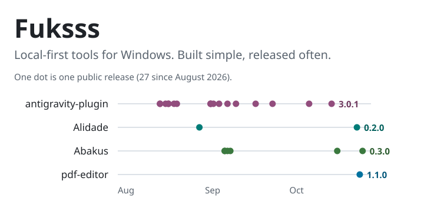
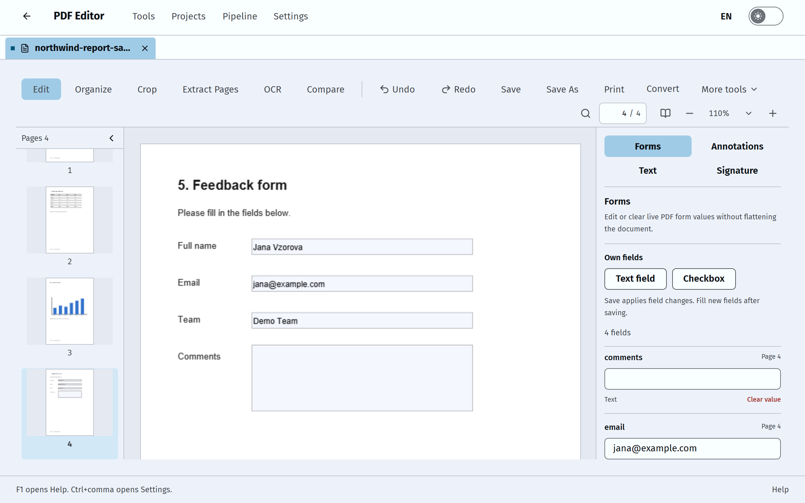
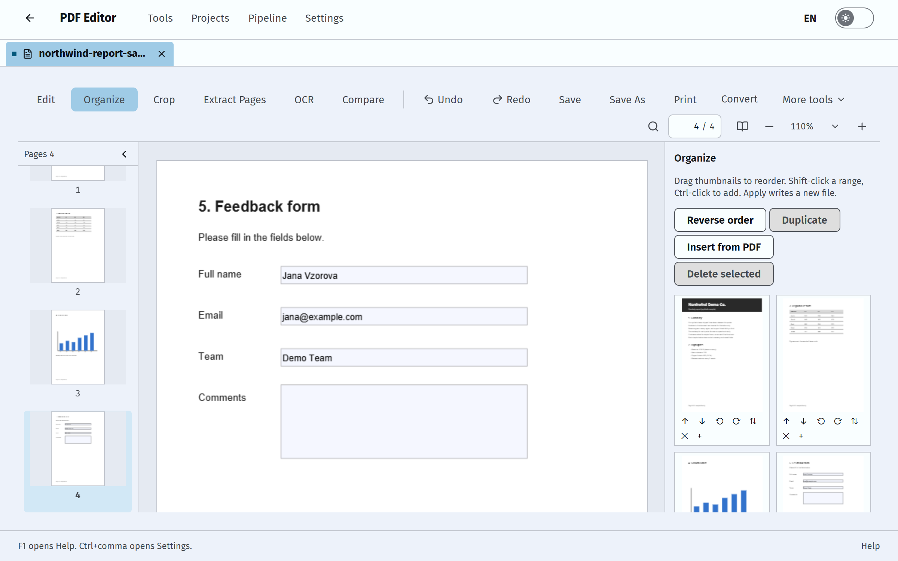
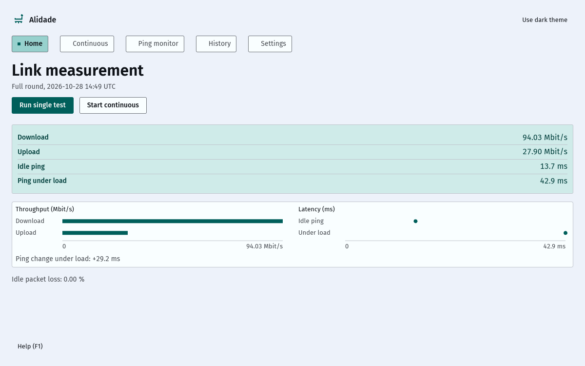
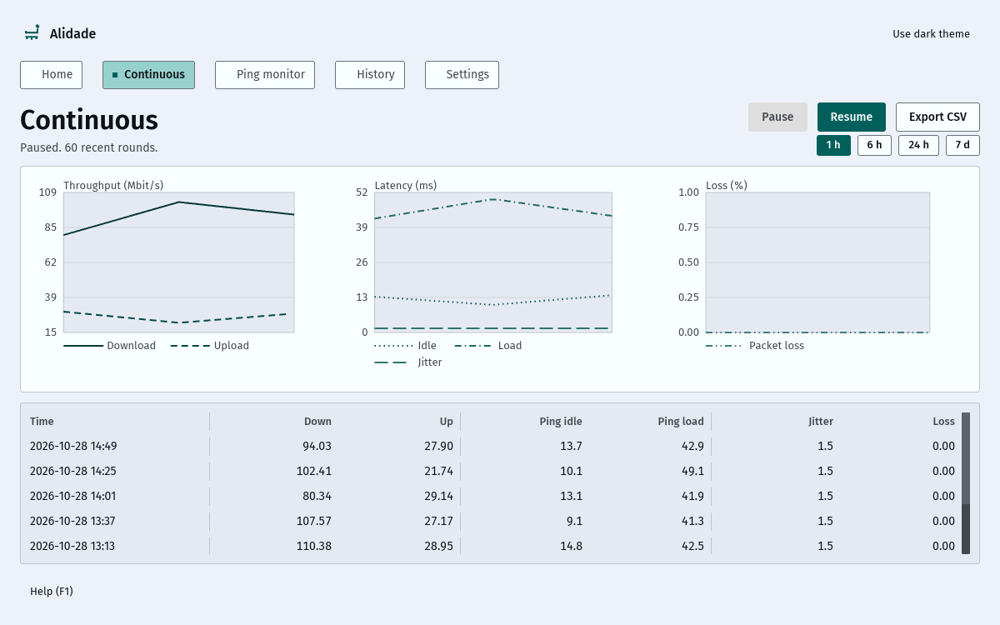
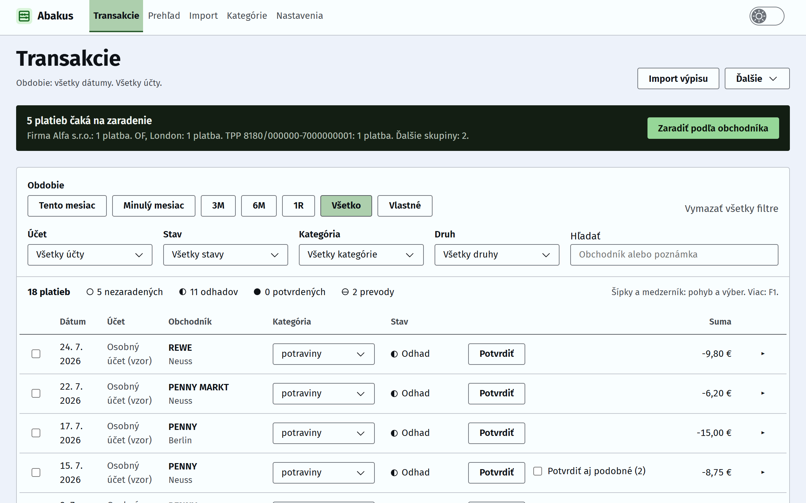
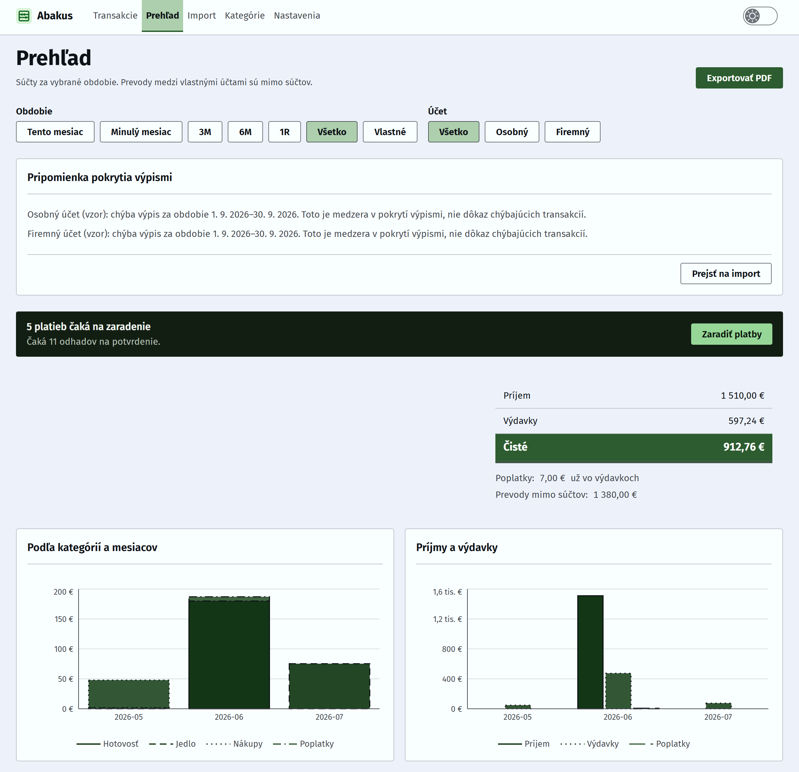
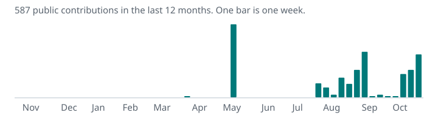

<picture>
  <source media="(max-width: 600px)" srcset="profile/header-mobile.svg" />
  
</picture>

I build complex things as simple as possible. My tools run on your computer, not on a server, and they keep your data there. Each change gets a second check before it ships. Now and then I also contribute to open-source tools I use, such as [T3 Code](https://github.com/pingdotgg/t3code).

## Apps

### [pdf-editor](https://github.com/SouthCarpet/pdf-editor) &nbsp;1.1.0

A PDF editor for Windows that works offline: forms, OCR, pages and annotations, with no telemetry and no paywall.
Tauri · React · Rust

<a href="https://github.com/SouthCarpet/pdf-editor"><picture><source media="(prefers-color-scheme: dark)" srcset="profile/pdf-editor-edit-dark.png" /></picture></a> <a href="https://github.com/SouthCarpet/pdf-editor"><picture><source media="(prefers-color-scheme: dark)" srcset="profile/pdf-editor-organize-dark.png" /></picture></a>

### [Alidade](https://github.com/SouthCarpet/Alidade) &nbsp;0.2.0

Measures a home internet link over time and keeps the record. The CSV export gives a complaint to the provider real numbers.
Rust · SQLite

<a href="https://github.com/SouthCarpet/Alidade"><picture><source media="(prefers-color-scheme: dark)" srcset="profile/alidade-home-dark.png" /></picture></a> <a href="https://github.com/SouthCarpet/Alidade"><picture><source media="(prefers-color-scheme: dark)" srcset="profile/alidade-continuous-dark.png" /></picture></a>

## Slovak-only apps

These apps are made for Slovakia, so their interface and description are in Slovak.

### [Abakus](https://github.com/SouthCarpet/Abakus) &nbsp;0.3.0

Číta mesačné PDF výpisy z Tatra banky, overí ich kontrolné súčty a rozdelí platby do kategórií. Ukáže príjmy, výdavky a pravidelné platby. Údaje zostanú na vašom počítači.
Rust · Tauri · Windows

<table><tr>
<td width="50%" valign="top"><a href="https://github.com/SouthCarpet/Abakus"><picture><source media="(prefers-color-scheme: dark)" srcset="profile/abakus-transactions-dark.png" /></picture></a></td>
<td width="50%" valign="top"><a href="https://github.com/SouthCarpet/Abakus"><picture><source media="(prefers-color-scheme: dark)" srcset="profile/abakus-overview-dark.png" /></picture></a></td>
</tr></table>

## Plugins

### [antigravity-plugin](https://github.com/SouthCarpet/antigravity-plugin) &nbsp;3.0.1

Sends code reviews, fixes and screenshot checks to Google's Antigravity CLI from Claude Code, Codex CLI, agy or a plain shell.
Node.js · <a href="https://www.npmjs.com/package/@southcarpet/antigravity-plugin">npm</a>

## Activity

<picture>
  <source media="(max-width: 600px)" srcset="profile/activity-mobile.svg" />
  
</picture>

Screenshots use sample data only. The charts are plain SVG files drawn from public GitHub data, with no third-party image service.
